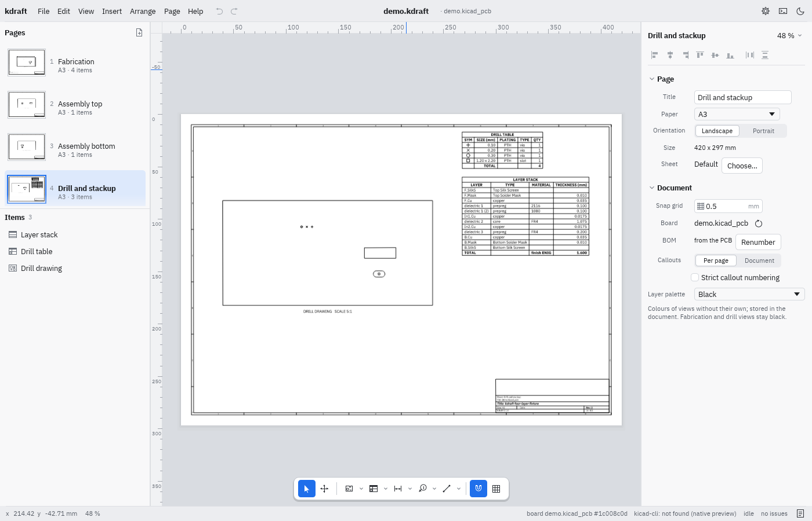
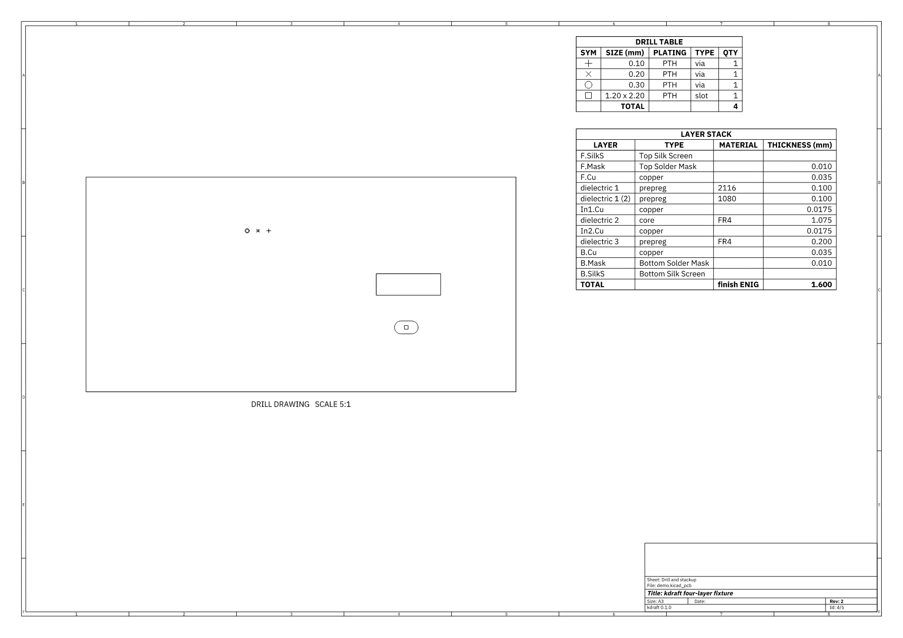

# kdraft

Fabrication and assembly drawings for KiCad boards: a native desktop editor
and a command-line tool, written in Rust. kdraft reads a `.kicad_pcb`, lays
out a drawing set (fabrication view, assembly views, drill drawing, drill
table, layer stack, bill of materials, notes, dimensions, callouts) on
KiCad drawing sheets and exports it as PDF, SVG or PNG. The model is
Altium Draftsman; the target is KiCad 9 and 10.

> **Written entirely by AI agents.** Every line of code, every test and
> all documentation in this repository, this file included, was written by
> AI coding agents (Anthropic's Claude). No code was written by hand. A
> person specified the tool, made the decisions, ran it on real boards and
> reported what was wrong. See [How it was written](#how-it-was-written).



An exported page (test board `fixtures/kicad10-minimal.kicad_pcb`, drawn
without KiCad installed):



## Status

Version 0.1.0, early. It is used on one real four-layer board (350
footprints) with KiCad 10.0.8 on Windows; expect rough edges.

| | |
| --- | --- |
| Run by a person | Windows with KiCad 10.0.8: the editor, plotted views (they match the board to 0.0000 mm at the pads), schematic BOM, 3D renders |
| Builds and passes its tests, editor window not tried | Linux |
| Not tried | macOS; KiCad 9.0.x (`kicad-cli`); board files written by KiCad 9 are parsed and tested |
| Units | millimetres only |

Not done yet: angular dimensions, ellipses, dragging table column widths,
a layer legend item, detail and section views, DXF export, a KiCad IPC
plugin (cross-probing), a size limit for the cache, UI languages other
than English. `docs/STATUS.md` lists what works and what has been checked
by a person; `docs/PLAN.md` holds the architecture and the roadmap.

## What it does

- **Pages and sheets.** Any number of pages, each on KiCad's default
  drawing sheet, the project's sheet or your own `.kicad_wks`. Pages are
  reordered by dragging; items align, distribute and snap (0.5 mm grid,
  anchors of other items).
- **Views of the board.** Fabrication, assembly top and bottom (reference
  designators placed without overlaps), drill drawing with one symbol per
  tool, single-layer views, and 3D views rendered by KiCad. With
  `kicad-cli` installed, views are KiCad's own plots; without it, kdraft
  draws a preview from the board file.
- **Tables.** Drill table (grouped like KiCad's drill files), layer stack,
  bill of materials from the schematic (`kicad-cli sch export bom`) or,
  without a schematic, from the board.
- **Annotations.** Linear, ordinate, radius and diameter dimensions with
  tolerances, attached to board features, so they follow the view when it
  moves or the board changes;
  numbered notes; callouts (free numbers, note, BOM item, designator);
  lines, polylines, rectangles and multi-line text; colours and line
  styles for all of them.
- **Layer colours.** Per view or per document: black, greyscale, KiCad's
  built-in themes (also adapted for white paper) or a colour theme
  imported from KiCad.
- **Placement links.** A view can follow another view's position, scale,
  rotation and colours across pages. "Layer pages" creates one page per
  copper layer, all at the same place.
- **Checks.** `kdraft check` and the editor report broken anchors, a
  board that changed since the drawing was made, overflowing tables,
  overlaps and designators that could not be placed.
- **One command table.** The editor's menus, the command palette (Ctrl+K)
  and `kdraft cmd run` use the same 100 or so commands, all undoable, so
  everything the editor does can be scripted.

kdraft never writes into your KiCad project: `kicad-cli` runs on a private
copy of the project files in a cache folder.

## Requirements

To build:

- **Rust** 1.92 or newer, stable toolchain, from <https://rustup.rs>
  (developed with 1.97). On Windows this is the MSVC toolchain; rustup
  asks for the Visual Studio C++ Build Tools if they are missing.
- **Git**.
- A few GB of free disk space for the build folder. No other libraries
  or SDKs: all dependencies are Rust crates that Cargo downloads.

To run:

- **Windows 10 or 11** (the target platform), with a graphics driver that
  provides OpenGL 2 or newer. For remote desktops and virtual machines
  without OpenGL there is a DirectX 12 / Vulkan build, see below.
- **KiCad 9 or 10**, optional but recommended. `kicad-cli` from the KiCad
  installation is needed for plot-exact views, the schematic BOM and 3D
  views. It is found on `PATH` or in `C:\Program Files\KiCad\<version>\bin`;
  another location can be set under File > Settings.

## Build

```
git clone https://github.com/mgandler/kdraft.git
cd kdraft
cargo build --release -p kdraft-ui -p kdraft-cli
```

This produces `target\release\kdraft-gui.exe` (the editor) and
`target\release\kdraft.exe` (the command-line tool). The first build
downloads and compiles a few hundred crates and takes several minutes.

Editor for machines without OpenGL (DirectX 12 / Vulkan through wgpu):

```
cargo build --release -p kdraft-ui --no-default-features --features wgpu
```

## Run

The editor, empty, with a board or with a drawing:

```
cargo run --release -p kdraft-ui --bin kdraft-gui
cargo run --release -p kdraft-ui --bin kdraft-gui -- path\to\board.kicad_pcb
cargo run --release -p kdraft-ui --bin kdraft-gui -- path\to\drawing.kdraft
```

Opening a `.kicad_pcb` creates a new drawing set; Save writes it next to
the board as `<board>.kdraft`. Layout, tools and shortcuts are described
in `docs/GUI.md`.

The same from the command line, with the test board in this repository:

```
cargo run --release -p kdraft-cli -- doc new fixtures/kicad10-minimal.kicad_pcb -o demo.kdraft
cargo run --release -p kdraft-cli -- check demo.kdraft
cargo run --release -p kdraft-cli -- export demo.kdraft -o demo.pdf
```

## Command line

```
kdraft inspect <board.kicad_pcb> [--json]
kdraft drill-table <board.kicad_pcb> [--json]
kdraft diff <old.kicad_pcb> <new.kicad_pcb> [--json]   # exit 1 if changed
kdraft sexpr-check <file>                              # byte-exact round trip
kdraft doc new <board.kicad_pcb> -o out.kdraft [--force]
kdraft doc validate <file.kdraft>
kdraft export <file.kdraft> -o out.pdf [--format pdf|svg|png] [--dpi N]
              [--kicad-cli PATH | --no-kicad-cli] [--sheet-from-kicad-cli]
kdraft check <file.kdraft> [--json]                    # exit 0 clean, 1 warnings, 2 errors
kdraft cmd list [--json]                               # the commands the editor uses
kdraft cmd run <file.kdraft> --do NAME [--args JSON] [--do ...] [-o out.kdraft]
kdraft settings path|show|reset
kdraft settings set <kicad_cli|define_vars|cache_dir|documents.KEY> <value>
kdraft settings palettes list
kdraft settings palettes import-kicad <theme.json> [--name N] [--no-adapt]
kdraft kicad list                                      # installs found, the one in use
```

Settings are shared by the editor and the command line and stored in
`%APPDATA%\kdraft\settings.json`; `--settings FILE` or `KDRAFT_SETTINGS`
select another file. `kicad-cli` is taken from `--kicad-cli`, else
`KDRAFT_KICAD_CLI`, else the setting, else the newest installation found.

Example: move page 1 to the end and left-align two items.

```
kdraft cmd run d.kdraft --do page.move --args "{\"from\": 0, \"to\": 2}" --do select.set --args "{\"ids\": [\"<id1>\", \"<id2>\"]}" --do layout.align --args "{\"mode\": \"left\"}"
```

## Development

```
cargo test --workspace
cargo fmt --all -- --check
cargo clippy --workspace --all-targets -- -D warnings
```

- `scripts/fetch-fixtures.sh` (bash or Git Bash) downloads KiCad's demo
  boards into `fixtures-ext/`; tests that use them skip themselves when
  the folder is absent.
- Tests that need a real `kicad-cli` are `#[ignore]`d and read
  `KDRAFT_KICAD_CLI`.
- Golden images of the renderer are regenerated with
  `KDRAFT_UPDATE_GOLDEN=1 cargo test -p kdraft-render`.
- `kdraft-gui --screenshot out.png [--script steps.json] file` renders
  the editor without a window; the first picture above was made this way.

| Crate | Purpose |
| --- | --- |
| `kdraft-sexpr` | Lossless S-expression reader and writer for KiCad files |
| `kdraft-board` | Board model: outline, footprints, holes, drill table, stackup, BOM |
| `kdraft-source` | Finding and running `kicad-cli`, cache, settings, KiCad colour themes |
| `kdraft-plot` | Reading KiCad's SVG plots and fitting them to board coordinates |
| `kdraft-sheet` | Drawing sheets (`.kicad_wks`) and project settings (`.kicad_pro`) |
| `kdraft-doc` | The `.kdraft` document: pages, views, tables, annotations, styles, links |
| `kdraft-layout` | Designator placement, dimension geometry, text layout |
| `kdraft-render` | Display list and output: PDF, SVG, PNG |
| `kdraft-engine` | Session, commands with undo, snapping, checks |
| `kdraft-ui` | The editor `kdraft-gui` (egui) |
| `kdraft-cli` | The command-line tool `kdraft` |

## Licence

kdraft is free software under the **GNU General Public License, version 3
or later** (`LICENSE`). Copyright (C) the kdraft authors.

## Credits

### Code and data taken from other projects

These are part of this repository. `NOTICE` and the `NOTICE` files under
`assets/` carry the full notices and licence texts.

| From | What | Where in kdraft | Licence |
| --- | --- | --- | --- |
| [KiCad](https://www.kicad.org) ([source](https://gitlab.com/kicad/code/kicad), tags 9.0.9 and 10.0.8) | The default drawing sheet, copied verbatim from `common/drawing_sheet/drawing_sheet_default_description.cpp` | `assets/sheets/default.kicad_wks` | GPL-2.0-or-later |
| KiCad (tag 10.0.8) | Board layer colours of the built-in themes "KiCad Default" and "KiCad Classic", from `common/settings/builtin_color_themes.h` and `common/gal/color4d.cpp`; the colour theme file format follows `common/settings/color_settings.cpp` | `crates/kdraft-doc/src/palette.rs`, `crates/kdraft-source/src/kicad_theme.rs` | GPL-3.0-or-later |
| [FigCraft](https://github.com/storytold/figcraft) (commit c01d391) | Structure of the UI theme tokens, the pixel-hinting icon painter helper, and the widget set and its interaction model (number fields with scrub and nudge, segmented control, section headers, drag ghost, inline rename). Colours, icons and the rest of the code are kdraft's own. | `crates/kdraft-ui/src/theme.rs`, `icons.rs`, `widgets.rs` | MIT OR Apache-2.0, used under MIT |
| [IBM Plex Sans](https://github.com/IBM/plex) 3.006 | Regular and Bold font files, embedded in the program and in exported PDFs | `assets/fonts/` | SIL Open Font License 1.1 |

Recorded output of KiCad used by the tests: the `kicad-cli` 10.0.8 help
texts in `fixtures/kicad-cli/` and the SVG plots in
`fixtures/kicad-cli-svg/`, which `kicad-cli` produced from kdraft's own
test board. KiCad's demo boards are downloaded by
`scripts/fetch-fixtures.sh` and are not part of this repository.

### Libraries

Linked as Cargo dependencies, not copied. The direct ones:

| Library | Used for | Licence |
| --- | --- | --- |
| [egui, eframe](https://github.com/emilk/egui) 0.37, with winit and glow (optionally wgpu) | The editor's user interface and window | MIT OR Apache-2.0 (winit: Apache-2.0; glow: MIT OR Apache-2.0 OR Zlib) |
| [krilla](https://github.com/LaurenzV/krilla) 0.8 | Writing PDF | MIT OR Apache-2.0 |
| [tiny-skia](https://github.com/linebender/tiny-skia) 0.12 | PNG output and the editor's page pictures | BSD-3-Clause |
| [ttf-parser](https://github.com/harfbuzz/ttf-parser) 0.25 | Font metrics and outlines | MIT OR Apache-2.0 |
| [roxmltree](https://github.com/RazrFalcon/roxmltree) 0.21 | Reading KiCad's SVG plots | MIT OR Apache-2.0 |
| [rfd](https://github.com/PolyMeilex/rfd) 0.18 | Native file dialogs | MIT |
| [clap](https://github.com/clap-rs/clap) 4 | Command-line parsing | MIT OR Apache-2.0 |
| [serde, serde_json](https://github.com/serde-rs/serde) 1 | Settings, command arguments | MIT OR Apache-2.0 |
| [blake3](https://github.com/BLAKE3-team/BLAKE3) 1 | Cache keys, board fingerprints | CC0-1.0 OR Apache-2.0 |
| [uuid](https://github.com/uuid-rs/uuid), [thiserror](https://github.com/dtolnay/thiserror), [anyhow](https://github.com/dtolnay/anyhow) | Identifiers, error types | MIT OR Apache-2.0 |
| [proptest](https://github.com/proptest-rs/proptest), [tempfile](https://github.com/Stebalien/tempfile), egui_kittest | Tests only | MIT OR Apache-2.0 |

`Cargo.lock` pins the complete dependency tree; `cargo tree` prints it.

### Ideas, no code

- **Altium Draftsman**: the kind of document, its views, tables and
  annotations.
- [PdfCraft](https://github.com/storytold/pdfcraft): one engine behind
  editor and command line, a command table that describes its own
  arguments, a pages panel with undoable page moves.
- [CADCraft](https://github.com/storytold/cadcraft): dimensions that stay
  attached to geometry, object snaps.
- FigCraft: the look and feel of the editor, beyond the adapted files
  listed above.

### How it was written

This project was written completely by AI agents: Anthropic's Claude in
Claude Code, with Claude Opus 5.5 as the implementing agent and Claude
Fable 5.2 planning, reviewing and making small fixes. That covers the
architecture plan, all source code, the tests and the documentation.

The repository starts with a single commit: the 61 commits of the
development before publication were squashed into it. Commit hashes
mentioned in `docs/` refer to that earlier history.

The human part: the idea and the requirements, the decisions (licence,
platform, units, where the BOM comes from), building and running it on
Windows with KiCad 10.0.8 on a real board, and bug reports and feature
requests from that use. What a person has and has not checked is recorded
in `docs/STATUS.md`. Read the code and the output with that in mind.

## Disclaimer

kdraft is an independent project. It is not affiliated with or endorsed
by the KiCad project or Altium. KiCad, Altium and Draftsman are
trademarks of their respective owners.
There is no warranty; check every drawing before it goes to a
manufacturer.
